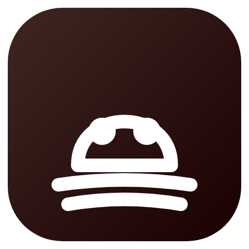

<h1 align="center">From The Fog: Full Russian Localization</h1>

  Complete Russian translation for From The Fog datapack and resourcepack v1.11.3 (Minecraft 1.20 - 1.21.x). 
  Полная русская локализация датапака и ресурспака From The Fog v1.11.3 (Minecraft 1.20 - 1.21.x).

  
  
  

  <a href="#english">English</a> | <a href="#русский">Русский</a>

---

## English

### Overview

This repository provides clean, standalone Russian localization files for **From The Fog v1.11.3 (Lunar Eclipse Studios)**.
It contains only configuration and text files to respect original author licensing and copyright requirements.

### Files

- `assets/lunareclipse.watching/lang/ru_ru.json`: All 657 localization keys translated and verified.
- `data/lunareclipse.watching/loot_table/`: Swedish Easter egg loot tables translated to Russian.
- `pack.mcmeta`: Pack metadata description.

### Installation

1. Download the pre-built `.zip` from [Releases](https://github.com/milkycloud-dev/from-the-fog-full-russian-localization/releases/latest).
2. Place it into your world `datapacks/` folder or client `resourcepacks/`.
3. Select Russian language in your client settings.

### Releases

Pre-built ready-to-use binaries (`.jar` / `.zip`) are available for download in [Releases](https://github.com/milkycloud-dev/from-the-fog-full-russian-localization/releases/latest).

### License

MIT License. Created by milkycloud-dev (2026).

---

## Русский

### Описание

Репозиторий содержит чистые файлы русской локализации для **From The Fog v1.11.3 (Lunar Eclipse Studios)**.
В состав включены исключительно файлы конфигурации и переводов, без бинарных сборок, с соблюдением требований лицензий авторов.

### Файлы

- `assets/lunareclipse.watching/lang/ru_ru.json`: Все 657 ключей локализации переведены и вычитаны.
- `data/lunareclipse.watching/loot_table/`: Таблицы добычи сундуков с переведенными названиями предметов.
- `pack.mcmeta`: Описание и метаданные пакета.

### Установка

1. Скачайте готовую сборку `.zip` из раздела [Releases](https://github.com/milkycloud-dev/from-the-fog-full-russian-localization/releases/latest).
2. Поместите архив в папку `datapacks/` мира или `resourcepacks/` клиента.
3. Выберите русский язык в настройках Minecraft.

### Релизы

Готовые собранные бинарные пакеты (`.jar` / `.zip`) доступны для загрузки в разделе [Releases](https://github.com/milkycloud-dev/from-the-fog-full-russian-localization/releases/latest).

### Лицензия

MIT License. Создано milkycloud-dev (2026).
